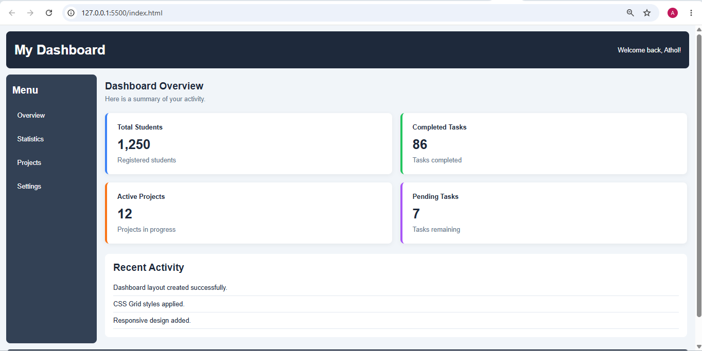

# Assignment 8.1 — Dashboard-Style Grid Layout

## 1. Aim

To create a basic dashboard webpage using CSS Grid, including a header, sidebar, main content area, and four statistic cards.

## 2. Requirements

- Visual Studio Code
- A web browser
- Basic knowledge of HTML and CSS

## 3. Procedure

1. Create a project folder named `Assignment-8.1`.
2. Create two files: `index.html` and `style.css`.
3. Design a dashboard header and sidebar using HTML.
4. Add four statistic cards to the main content area.
5. Use `display: grid`, `grid-template-columns`, and `grid-template-rows` to arrange the layout.
6. Add gaps, colors, borders, and responsive styling.
7. Open the webpage in a browser and inspect the layout.
.

## 4. Result

The dashboard webpage was created successfully using HTML and CSS Grid. It contains a header, sidebar, main content section, and four statistic cards. The layout adjusts to smaller screens using CSS media queries.

## 6. Conclusion

This assignment demonstrates the use of CSS Grid to create a structured dashboard layout. It provides practical experience with grid rows, columns, spacing, responsive design, and webpage organization.

## Key CSS Grid concepts used

| CSS property                | Purpose                                  |
| --------------------------- | ---------------------------------------- |
| `display: grid`             | Enables CSS Grid layout.                 |
| `grid-template-columns`     | Defines the width and number of columns. |
| `grid-template-rows`        | Defines the layout's rows.               |
| `grid-template-areas`       | Assigns named regions to the dashboard.  |
| `gap`                       | Adds space between grid items.           |
| `repeat(2, minmax(0, 1fr))` | Creates two equal-width card columns.    |
| `@media`                    | Adjusts the layout for smaller screens.  |

Expected result: A dark header at the top, a vertical sidebar on the left, four statistic cards arranged in two columns, a recent-activity section, and a footer. On mobile screens, the sidebar and content stack vertically, and the statistic cards become a single column.

## 6. SCREENSHOT OF OUTPUT
